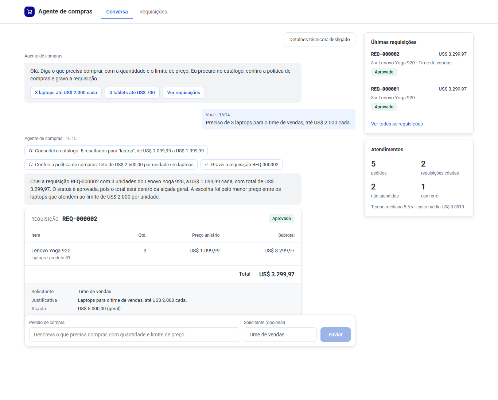

<div align="center">

# 🛒 Agente de compras

**Você escreve o que precisa. O agente busca no catálogo, confere as regras e grava a requisição.**<br>
Preço, total e estoque vêm sempre da fonte, nunca do texto do modelo.


Case técnico do processo seletivo de **AI Forward Deployed Engineer** do Mercado Eletrônico

[Rodar](#rodar-em-3-passos) · [Como funciona](#como-funciona) · [Decisões](#decisões) · [Testes](#testes-e-avaliação)

</div>

## O pedido de exemplo

```text
você    Preciso de 3 laptops para o time de vendas, até US$ 2.000 cada.

agente  buscar_produtos("laptop")                               5 resultados · 848 ms
        consultar_politica("laptops")                                       53 ms
        criar_requisicao([{ produto_id: 81, quantidade: 3 }])               286 ms

        Requisição REQ-000001 · aprovada
        3 × Lenovo Yoga 920          US$ 1.099,99          US$ 3.299,97
                                     Total                 US$ 3.299,97
```

<p align="center">
  
</p>

## Rodar em 3 passos

Só precisa de Docker com Compose v2.

```bash
cp .env.example .env        # 1. abra o .env e preencha OPENROUTER_API_KEY
docker compose up --build   # 2. sobe postgres, mcp-server, backend e chat
```

**3.** Abra **http://localhost:8080** e escreva o pedido. O botão **Detalhes técnicos**, no alto da
conversa, mostra cada ferramenta chamada, com argumentos, tempo, tokens e custo.

> [!TIP]
> Usa um agente de IA (Claude Code, Codex, Cursor)? Abra o repositório e peça **"siga o INSTALAR.md"**.
> O [`INSTALAR.md`](INSTALAR.md) instala, sobe e testa o projeto passo a passo.

A rota do enunciado também responde direto, com a requisição lida do banco, a mensagem do modelo e as
ferramentas chamadas ([exemplo real e as outras rotas](docs/api.md)):

```bash
curl -s http://localhost:8080/requisicoes -H "content-type: application/json" \
  -d '{"pedido": "Preciso de 3 laptops para o time de vendas, até US$ 2.000 cada."}'
```

Se nada atende, nada é gravado e a resposta diz o que faltou:

> *"Não criei a requisição: nenhum laptop do catálogo fica até US$ 1.000 por unidade. O mais barato é o
> Lenovo Yoga 920, a US$ 1.099,99, com 40 em estoque."*

## Como funciona

```text
┌────────────────────┐
│ Chat · React       │  localhost:8080
└─────────┬──────────┘
          │ POST /api/requisicoes
┌─────────▼──────────┐    pedido + ferramentas   ┌──────────────────┐
│ Backend · Fastify  │ ────────────────────────► │ LLM · OpenRouter │
│ laço do agente     │ ◄──────────────────────── │ escolhe o passo  │
└─────────┬──────────┘   qual ferramenta chamar  └──────────────────┘
          │ MCP por HTTP
┌─────────▼──────────┐                           ┌──────────────────┐
│ Servidor MCP       │ ────────────────────────► │ DummyJSON        │
│ 4 ferramentas      │   busca e confere preço   │ catálogo         │
└─────────┬──────────┘                           └──────────────────┘
          │ criar_requisicao, numa transação
┌─────────▼──────────┐
│ Postgres           │  requisições, itens, política e histórico
└────────────────────┘
```

O backend repete a conversa com o modelo, no máximo 8 voltas, até ele responder. Não existe fluxo fixo
no código: quem decide a próxima ferramenta é o modelo ([arquitetura](docs/arquitetura.md)).

| Ferramenta do MCP | O que faz |
|---|---|
| `buscar_produtos` | Busca no catálogo e devolve preço, estoque, pedido mínimo e categoria |
| `detalhar_produto` | Devolve o produto completo, com garantia e prazo de envio |
| `consultar_politica` | Devolve as regras de compra que valem: categoria bloqueada, teto, quantidade máxima e alçada |
| `criar_requisicao` | Grava a requisição. **Não recebe preço:** lê na fonte, aplica a política e grava numa transação |

## Decisões

**1. O LLM decide, o código garante.**

| 🧠 O modelo decide | 🔒 O código garante |
|---|---|
| quais ferramentas chamar e em que ordem | o preço, lido na fonte por `criar_requisicao` |
| qual produto atende o pedido | total em centavos, estoque e pedido mínimo |
| como traduzir "notebook" para a busca | teto, quantidade máxima, categoria e alçada da política |
| como explicar o que faltou | o número que a pessoa vê, lido do banco; se nada atende, nada é gravado |

**2. Olhei o dado antes de escrever o prompt.** A busca da DummyJSON só acha em inglês e no singular e
traz ruído (`monitor` devolve uma panela), e 156 de 194 produtos têm pedido mínimo. O prompt e as
travas nasceram disso.

**3. Política de compras em tabela, não no código.** Alçada, teto por unidade, quantidade máxima e
categoria bloqueada mudam pela API com o `POLITICA_TOKEN`, valem no pedido seguinte e têm histórico por
trigger ([política](docs/politica.md)).

**4. Sem framework de agente.** O laço de tool calling é curto o bastante para ler inteiro
(`services/backend/src/agente/laco.ts`), com o SDK oficial do MCP por Streamable HTTP.

**5. Erro tem código, não só texto.** O chat explica cada falha (catálogo fora, chave inválida, MCP fora)
sem depender do modelo.

**6. Instrumentado.** Cada atendimento grava ferramentas, argumentos, tempos, tokens e custo
(`GET /api/atendimentos/{id}`), e `/api/metricas` resume.

**7. Modelo `anthropic/claude-haiku-5.5`**, com `deepseek/deepseek-v4.1-flash` de reserva, os dois pela
OpenRouter e por variável de ambiente.

**8. Seguro por padrão.** O chat só responde em `127.0.0.1`, mudar a política exige `POLITICA_TOKEN` e o
servidor MCP recusa `Origin` de fora do localhost. O que está protegido e o que ficou de fora:
[segurança](docs/seguranca.md).

## Testes e avaliação

```bash
docker compose run --rm --build testes                    # lint, tipos e testes, sem chave de LLM e sem internet
docker compose run --rm --build testes npm run avaliar    # 6 pedidos conferidos no banco (ambiente no ar e chave no .env)
```

Avaliação real de 01/11/2026 com o Haiku 5.5, uma rodada dos 6 pedidos:

| Acertos | Tempo p50 | Tempo p95 | Custo por pedido |
|:---:|:---:|:---:|:---:|
| **6 de 6** | 7,7 s | 12,9 s | US$ 0,0015 |

O CI roda lint, tipos, testes com Postgres e o build das imagens a cada push.

## Como usei IA

Usei o **Claude Code** (Anthropic) como par de programação no planejamento, no código e nos testes,
com revisão minha antes de cada commit.

## Se algo der errado

- **Porta 8080 ocupada:** ponha `PORTA=8081` no `.env`.
- **O chat diz que a chave é inválida, venceu ou está sem crédito:** ponha outra em `OPENROUTER_API_KEY` e rode `docker compose up -d`.
- **Banco do zero:** `docker compose down -v`.

Variáveis e padrões: [configuração](docs/configuracao.md).

<details>
<summary><b>Para produção, eu faria</b></summary>

- Login do cliente (SSO ou OAuth) e isolamento por empresa.
- O catálogo real do cliente no lugar da DummyJSON, por API ou pelo OData do ERP.
- Aprovar e reprovar com motivo, alçada por solicitante e aviso por webhook.
- Fila para pedidos em lote, com reprocessamento e fila de erro.
- Métricas exportadas (OpenTelemetry), com alerta de taxa de erro e de custo.
- Avaliação contínua no CI a cada mudança de prompt ou de modelo.

</details>

---

<div align="center">

**Mais detalhes:** [arquitetura](docs/arquitetura.md) · [API](docs/api.md) · [política](docs/politica.md) · [segurança](docs/seguranca.md) · [configuração](docs/configuracao.md)

</div>
